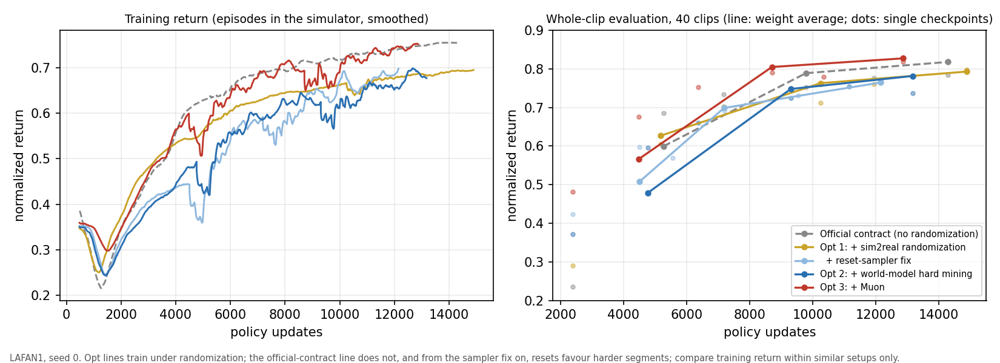

# SuperMimic on the Unitree G1: a reproduction with receipts

[](https://arxiv.org/abs/2610.28480)
[](https://github.com/HybridRobotics/supermimic)
[](https://github.com/CuboiLeo/SuperMimic-Reproduced)

An independent reproduction of SuperMimic (a tracking policy trained by backpropagating through a learned world model)
on the Unitree G1 with mjlab / MuJoCo Warp and LAFAN1, three measured improvements, and stairs up to 20 cm with a
height scan, using the same algorithm and flat reference motions.



## TL;DR

- **Reproduced:** 40/40 LAFAN1 clips at 0.818, also with sensor noise and in plain MuJoCo; matches the base repository within ±0.03.
- **Long clips need heading, not position:** proprioception alone drifts ~2°/s; the reference orientation fixes it.
- **Improved:** randomization through the world model (2-step delay 0/40 → 38/40), world-model hard mining, Muon (0.781 → 0.827).
- **Stairs:** 20 cm up / down / random steps without a fall in 0.93 / 0.92 / 1.00 of windows; 0.00–0.03 with the scan flattened.

Why each choice was made, with evidence and pitfalls: **[docs/NOTES.md](docs/NOTES.md)**.

## Results

LAFAN1, 40 whole clips (100–300 s), seed 0, paper Appendix F protocol, return normalized by planned steps.
Weight average of the last 4 checkpoints.

| Policy | Updates | Completed | Return |
|---|---:|---:|---:|
| Paper observations (proprioception only) | 23.3k | 39/40 | 0.665 |
| **Official contract** (main reproduction) | 14.3k | **40/40** | **0.818** |
| Full anchor (deviation, needs global position) | 24.8k | 40/40 | 0.926 |
| Opt 1: + sim2real randomization | 14.9k | 39/40 | 0.793 |
| Opt 2: + sampler fix, world-model hard mining | 13.2k | 40/40 | 0.781 |
| Opt 3: + Muon | 12.9k | 40/40 | 0.827 |

Opt lines train under randomization and are compared with each other, not with the nominal rows.
Robustness, held-out and sim2sim numbers are in [NOTES §2, §5](docs/NOTES.md).

**Stairs** (terrain level 1, warm-started from Opt 3; 10 s windows on walk/run segments, 128 per cell, nominal, one seed):

| 20 cm steps | No fall | Climbed | Flat policy before training (no fall) |
|---|---:|---:|---:|
| Up | 0.93 | 0.90 | 0.08 |
| Down | 0.92 | 0.79 | 0.27 |
| Random step heights | 1.00 | 0.98 | 0.46 |

Flat-ground LAFAN40 after stairs training: 40/40, 0.824 (0.827 before). Details in [NOTES §10](docs/NOTES.md#10-stairs-terrain-level-1).
Caveat: the scan is idealized in simulation (no blind cells under the body, simple noise); hardware needs a
real-to-sim scan model first.

## Repository layout

| Folder | What it is | Docs |
|---|---|---|
| [`variants/`](variants/) | Our changes as patch series on a pinned base commit, one variant per idea | [PIPELINE §13](docs/PIPELINE.md) |
| [`configs/`](configs/) | Frozen training configs and evaluation protocols | [protocols](configs/protocols/) |
| [`infra/`](infra/) | RunPod session driver, budget watchdogs, on-Pod evaluation suites | [README](infra/runpod/README.md) |
| [`tools/`](tools/) | Offline analysis (drift, failures, world-model error), closed-loop CPU sim2sim, local terrain environment | [NOTES §5, §10](docs/NOTES.md) |
| [`scripts/`](scripts/), [`tests/`](tests/) | Variant checkout, unit tests | |
| [`docs/`](docs/) | NOTES (start here), PIPELINE (rules), decision log | [NOTES](docs/NOTES.md) |
| `upstream/` | SuperMimic-Reproduced as a submodule | |

## Usage

Rebuild a variant's source tree from its base commit and patch chain (the result is checked against `variant_tree`):

```bash
scripts/checkout_variant.sh variants/cuboi-g1/official-contract
```

Every training run starts from a frozen config in `configs/cuboi-g1/` through `infra/runpod/session_driver.py`; the
evaluation protocols are in `configs/protocols/`. Account settings for RunPod go in `.secrets/runpod-site.json`
(see `infra/runpod/site.example.json`). Tests: `python3 -m pytest tests`.

LAFAN1, BONES-SEED and anything rendered from them may not be redistributed; only manifests are committed.

## Acknowledgements

Built on [SuperMimic-Reproduced](https://github.com/CuboiLeo/SuperMimic-Reproduced) (Yuxi Liu, MIT) and checked against
the [official code](https://github.com/HybridRobotics/supermimic). Compared with or read for ideas:
[InstantTrack](https://github.com/Huy-Quang-Dao/instantTrack), [supermimic_vibed](https://github.com/zita-ch/supermimic_vibed),
[BlinkMimic](https://github.com/fuyichen0725/blinkmimic), [allmimic](https://github.com/Shimingyi/allmimic),
[supermimic-reproduce](https://github.com/Go-Youngster/supermimic-reproduce); for stairs,
[InstinctMJ](https://github.com/project-instinct/InstinctMJ) (ideas only). Simulator:
[mjlab](https://github.com/mujocolab/mjlab), MuJoCo. Data: LAFAN1 (Harvey et al., 2020) and BONES-SEED. Full list in
[NOTES §14](docs/NOTES.md#14-references).

## Citation

```bibtex
@article{liao2026supermimic,
  title   = {SuperMimic: Scaling Humanoid Whole-Body Control with One Differentiable World Model},
  author  = {Liao, Qiayuan and Shao, Yiyang and Long, Junfeng and Zakka, Kevin and Horowitz, Roberto and Abbeel, Pieter and Sreenath, Koushil},
  journal = {arXiv preprint arXiv:2610.28480},
  year    = {2026}
}
@misc{zakka2026mjlab,
  title  = {mjlab: A Lightweight Framework for GPU-Accelerated Robot Learning},
  author = {Zakka, Kevin and Liao, Qiayuan and Yi, Brent and Le Lay, Louis and Sreenath, Koushil and Abbeel, Pieter},
  year   = {2026},
  eprint = {2601.22074},
  archivePrefix = {arXiv}
}
```

## License

[MIT](LICENSE) for the code in this repository. The patches in `variants/` modify
[SuperMimic-Reproduced](https://github.com/CuboiLeo/SuperMimic-Reproduced) (MIT, © 2026 Yuxi Liu) and InstantTrack (MIT);
mjlab and MuJoCo are Apache-2.0. Datasets keep their own licenses and are not included.
